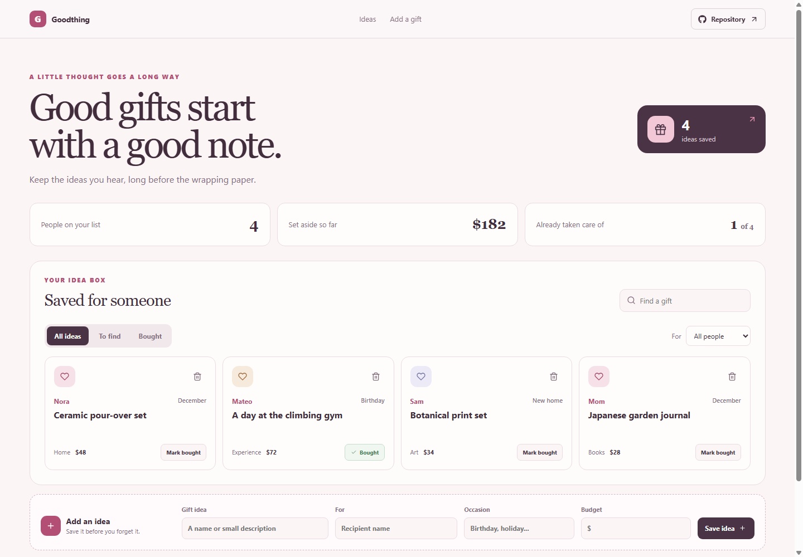

# Goodthing: Gift Idea Organizer

Goodthing keeps gift ideas, recipients, occasions, and planned budgets together so you can save an idea before you forget it.



**Live demo:** [a2rp.github.io/gift-idea-organizer](https://a2rp.github.io/gift-idea-organizer/)

## Features

- Save an idea with a recipient, occasion, and optional budget.
- Search by recipient, gift name, or category.
- Filter by recipient and by all, to-find, or bought status.
- Mark gifts as bought and review the planned budget total.
- Delete an idea after confirming its name.

## Data and currency

Gift ideas are saved in this browser with `localStorage`; they do not sync across browsers or devices. A fresh browser starts with sample ideas. If browser storage is unavailable, the app shows that changes will not persist after you leave. Budget values are displayed in US dollars.

## Run locally

```bash
npm install
npm run dev
```

## Checks and deployment

```bash
npm run lint
npm run build
npm run deploy
```

The deploy command builds the app and publishes `dist` to the `gh-pages` branch. It requires this public repository to be configured as the Git origin.

## Planned ideas

- Add notes, sizes, and preferred stores to an idea.
- Group ideas into shared occasion lists.
- Export the list as a printable gift plan.

## Links

- Portfolio: [ashishranjan.net](https://www.ashishranjan.net/)
- GitHub: [a2rp](https://github.com/a2rp)
