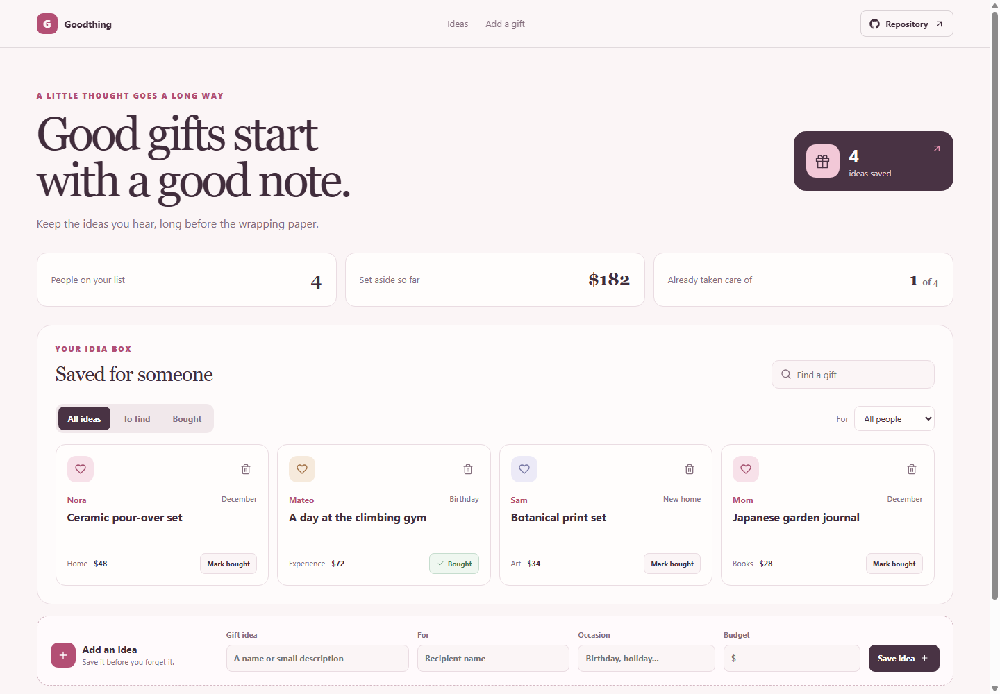

# Goodthing: Gift Idea Organizer

Goodthing gives you one quiet place to remember gift ideas, who they are for, and what you planned to spend. It is useful when you hear an idea months before a birthday or holiday.

**GitHub Pages URL:** https://a2rp.github.io/gift-idea-organizer/ (available after deployment)

## Included

- Save a gift idea with recipient, occasion, and optional budget.
- Search by recipient, gift name, or category.
- Filter by person and by all, to-find, or bought status.
- Mark ideas bought and see the set-aside total and completion count.
- Remove an idea only after confirming the named item in a dialog.

## How to use it

Search or choose a person to narrow the idea cards. Use Mark bought when you have found a gift. Add a person and gift in the form at the bottom, then save the idea.

## Data and limits

Gift ideas are stored in this browser with localStorage. They do not sync between browsers or devices. Budget totals sum the optional amounts entered for each idea.

This is a browser-only utility. Clearing the browser’s site data removes its saved information.

## Run locally

~~~sh
npm install
npm run dev
~~~

## Checks and deployment

~~~sh
npm run lint
npm run build
npm run deploy
~~~

The deploy command builds the project and publishes the dist directory to the gh-pages branch. It requires the project’s public GitHub repository to be configured as origin.

## Future improvements

Ideas only. These are not implemented yet:

- Add notes, sizes, and preferred stores to an idea.
- Group ideas into shared occasion lists.
- Export the list as a printable gift plan.

## Links

- Portfolio: [https://www.ashishranjan.net](https://www.ashishranjan.net)
- GitHub: [https://github.com/a2rp](https://github.com/a2rp)
- CodePen: [https://codepen.io/ash1198](https://codepen.io/ash1198)
- LinkedIn: [https://www.linkedin.com/in/aashishranjan](https://www.linkedin.com/in/aashishranjan)
- Facebook: [https://www.facebook.com/theash.ashish/](https://www.facebook.com/theash.ashish/)
- YouTube: [https://www.youtube.com/@ashishranjan-ashz?sub_confirmation=1](https://www.youtube.com/@ashishranjan-ashz?sub_confirmation=1)
- Email: [mailto:ash.ranjan09@gmail.com](mailto:ash.ranjan09@gmail.com)

## Support

- Support: [https://a2rp-donation-page.netlify.app/](https://a2rp-donation-page.netlify.app/)
- Buy Me a Coffee: [https://buymeacoffee.com/ashishranjan](https://buymeacoffee.com/ashishranjan)
- Patreon: [https://www.patreon.com/ashishranjan](https://www.patreon.com/ashishranjan)